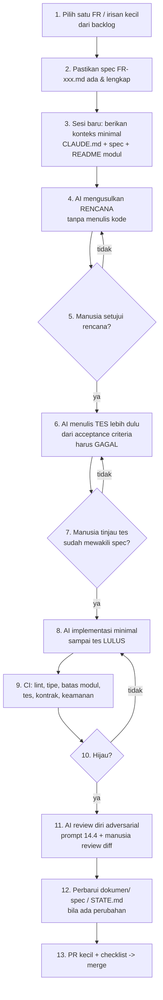

# NETBILL PRO: AI-ASSISTED DEVELOPMENT PLAYBOOK (SPEC-DRIVEN)

### Kontrol Dokumen

| Atribut | Detail |
| :--- | :--- |
| **ID Dokumen** | DEV-RTRW-2026-001 |
| **Versi** | 1.0 (Draft for Review) |
| **Tanggal** | 13 November 2026 |
| **Dokumen Induk** | PRD-RTRW-2026-001 v1.1, TDD-RTRW-2026-001 v1.1 |
| **Tujuan** | Mengendalikan pembangunan dengan bantuan AI (vibe coding) agar hasilnya **sesuai dokumen, dapat diuji, dan aman untuk data keuangan** |
| **Pembaca** | Pemilik produk, developer/pengarah AI, reviewer |

---

## Daftar Isi

1. Prinsip Inti: dari "Vibe" ke "Spec-Driven"
2. Hierarki Sumber Kebenaran & Aturan Konflik
3. Struktur Dokumen & Repositori untuk Pengembangan Berbantuan AI
4. Zona Risiko (Merah / Kuning / Hijau)
5. Alur Kerja Baku per Tugas
6. Guardrail Otomatis (Penegak yang Tidak Bergantung pada Ingatan AI)
7. Risiko Khas Pengembangan Berbantuan AI & Mitigasi
8. Manajemen Konteks & Memori Antar Sesi
9. Peran Manusia: Yang Tidak Boleh Didelegasikan
10. Keterlacakan (Traceability)
11. Dokumen Tambahan yang Perlu Dilengkapi Sebelum Menulis Kode
12. Dampak ke Master Roadmap
13. Readiness Checklist: Kapan Boleh Mulai Meminta AI Menulis Kode
14. Lampiran Template (siap salin)

---

## 1. Prinsip Inti: dari "Vibe" ke "Spec-Driven"

### 1.1 Penilaian Jujur

Pengembangan berbantuan AI sangat cepat menghasilkan kode, tetapi **kecepatan itu memindahkan hambatan dari menulis ke memverifikasi**. Pada aplikasi billing, kesalahan yang paling berbahaya adalah yang **terlihat benar**: saldo meleset satu rupiah, alokasi pembayaran salah urutan, atau endpoint yang membocorkan data pelanggan lain. AI cenderung menghasilkan kode yang meyakinkan, lolos "klik-klik" manual, tetapi gagal pada kasus tepi.

Karena itu pendekatan yang disarankan adalah **spec-driven**, bukan "vibe":

> **Manusia memiliki niat (dokumen) dan verifikasi (tes + review). AI memiliki pengetikan kode (implementasi).**

### 1.2 Lima Prinsip

| # | Prinsip | Artinya dalam praktik |
| :--- | :--- | :--- |
| 1 | **Dokumen adalah niat, tes adalah penegak** | Setiap aturan penting di PRD/TDD harus punya padanan yang *dapat dieksekusi*: tes, skema, tipe, constraint DB, aturan lint |
| 2 | **Tes dulu, kode kemudian** | AI menulis tes dari spesifikasi lebih dulu (harus gagal), baru implementasi. Tes tidak boleh diubah untuk meluluskan kode tanpa persetujuan manusia |
| 3 | **Potongan kecil, terverifikasi** | Satu tugas = satu irisan vertikal kecil (satu FR atau bagian). Tidak ada perubahan raksasa |
| 4 | **Zona risiko menentukan tingkat pengawasan** | Ledger/pembayaran/auth diperlakukan sangat ketat. UI/gaya boleh lebih longgar |
| 5 | **Konteks ditulis, bukan diingat** | AI tidak mengingat antar sesi. Semua keputusan dan aturan harus ada di berkas di repositori |

### 1.3 Analogi Kerja
Perlakukan AI seperti **developer junior yang sangat cepat dan sangat percaya diri**: ia butuh spesifikasi jelas, dibatasi area kerjanya, hasilnya selalu diperiksa oleh tes dan reviewer, dan ia tidak diberi wewenang atas keputusan arsitektur atau keuangan.

---

## 2. Hierarki Sumber Kebenaran & Aturan Konflik

Bila dua sumber bertentangan, yang **lebih tinggi menang**:

| Peringkat | Sumber | Contoh |
| :---: | :--- | :--- |
| 1 | **Keputusan Owner/PO yang tercatat** (`decisions.log`, Open Questions terjawab) | "Tagihan pertama: penuh" |
| 2 | **PRD** (apa dan aturan bisnis) | Bagian 6 ledger, S1-S8 |
| 3 | **TDD & ADR** (bagaimana) | Skema DB, algoritma, batas modul |
| 4 | **Spesifikasi fitur** (`docs/specs/FR-*.md`) | Turunan terperinci dari PRD |
| 5 | **Kontrak yang dapat dieksekusi** | OpenAPI, skema Zod, migrasi DB, constraint & trigger |
| 6 | **Tes otomatis** | Skenario S1-S8, uji properti |
| 7 | **Kode** | Implementasi |

**Aturan:**
1.  Kode atau tes yang bertentangan dengan peringkat di atasnya adalah **bug**, kecuali ada perubahan dokumen yang disetujui.
2.  **AI tidak boleh mengubah dokumen peringkat 1-4 secara sepihak.** Bila menemukan dokumen salah/ambigu/bertentangan, AI wajib **berhenti dan bertanya** (lihat 5.4), bukan memilih sendiri.
3.  Perubahan dokumen dilakukan lewat *change request* kecil: ubah dokumen → catat di `decisions.log` → perbarui spec/tes → baru kode.
4.  Bila dokumen dan kode berbeda, **perbaiki salah satunya segera**. Jangan membiarkan dokumen usang.

---

## 3. Struktur Dokumen & Repositori untuk Pengembangan Berbantuan AI

```
netbill-pro/
├─ CLAUDE.md                     # aturan untuk agen AI (nama berkas menyesuaikan alat; lihat 14.1)
├─ AGENTS.md                     # salinan/tautan bila memakai alat lain
├─ docs/
│  ├─ prd/PRD-RTRW-2026-001_v1.1.md
│  ├─ tdd/TDD-RTRW-2026-001_v1.1.md
│  ├─ adr/ADR-0001-*.md ...      # satu berkas per keputusan
│  ├─ specs/                     # spesifikasi fitur per FR (14.2)
│  │  ├─ FR-PAY-02_post-payment.md
│  │  ├─ FR-BIL-01_billing-generator.md
│  │  └─ ...
│  ├─ test-plan/                 # skenario uji, data uji (S1-S8, T-9..T-20)
│  ├─ ui/                        # wireframe, spesifikasi layar, status & label
│  ├─ data-dictionary.md         # arti tiap tabel/kolom/status
│  ├─ glossary.md
│  ├─ decisions.log              # log keputusan (14.7)
│  ├─ STATE.md                   # status proyek terkini (untuk handover sesi)
│  └─ do-not-do.md               # daftar larangan (14.8)
├─ contracts/
│  ├─ openapi.yaml               # kontrak API (sumber untuk klien & uji kontrak)
│  └─ events/*.schema.json       # skema domain event berversi
├─ db/migrations/
├─ apps/ ... packages/ ...       # sesuai TDD Bagian 5
├─ modules/<x>/README.md         # paket konteks per modul (tanggung jawab, kontrak, larangan)
└─ .github/
   ├─ pull_request_template.md   # 14.5
   ├─ CODEOWNERS                 # 14.6
   └─ workflows/ci.yml
```

**Mengapa `modules/<x>/README.md` penting:** AI bekerja paling baik bila hanya diberi konteks yang relevan. README per modul adalah "paket konteks" yang bisa dilampirkan ke satu sesi tanpa memuat seluruh PRD.

---

## 4. Zona Risiko

Tingkat pengawasan mengikuti dampak kesalahan.

| Zona | Area | Aturan |
| :---: | :--- | :--- |
| 🔴 **Merah** | `ledger`, alokasi pembayaran, `billing` (generator, penomoran), `payments` (void, idempotensi), `auth`, RBAC/otorisasi, enkripsi secret, migrasi DB, backup/restore | **Spesifikasi + tes ditulis/ditinjau manusia lebih dulu.** AI hanya menulis implementasi. **2 reviewer** (atau 1 reviewer + pemeriksaan mandiri terhadap checklist). Uji properti + mutation testing wajib. Tidak ada merge otomatis |
| 🟡 **Kuning** | CRUD pelanggan/paket, laporan, notifikasi & template, impor CSV, PDF, pengaturan | AI menulis tes + implementasi, manusia meninjau diff dan menjalankan skenario. Tes integrasi wajib |
| 🟢 **Hijau** | Gaya/UI presentasi, salinan teks, komponen visual, dokumentasi, skrip bantu | Review ringan, tes sesuai kebutuhan, tidak boleh menyentuh logika bisnis |

`CODEOWNERS` memaksa zona merah dan dokumen peringkat 1-4 selalu butuh persetujuan pemilik.

---

## 5. Alur Kerja Baku per Tugas

### 5.1 Siklus (Wajib Diikuti)



### 5.2 Aturan Ukuran Tugas

*   Satu PR = **satu FR atau satu irisan vertikal** (migrasi + service + API + UI minimal + tes).
*   Panduan: diff **≤ ~300 baris bermakna** (di luar berkas buatan). Lebih dari itu dipecah.
*   Dilarang mencampur **refactor** dengan **fitur** dalam satu PR.
*   Satu sesi AI = satu tugas. Mulai sesi baru untuk tugas berikutnya (lihat Bagian 8).

### 5.3 Perilaku yang Diwajibkan pada AI

1.  Baca `CLAUDE.md`, spec, dan README modul **sebelum** menulis kode.
2.  Mulai dengan **rencana ringkas** (berkas yang akan diubah, tes yang akan ditulis, asumsi, risiko). Tunggu persetujuan.
3.  **Tes sebelum implementasi.**
4.  Gunakan **pola dan utilitas yang sudah ada** (cari dulu sebelum membuat baru). Tidak menciptakan pola paralel.
5.  Tidak menambah dependensi, mengubah migrasi lama, mengubah tes yang ada, atau menyentuh zona merah di luar tugas **tanpa izin eksplisit**.
6.  Menyatakan **apa yang tidak ia verifikasi** dan asumsi yang dibuat. Dilarang mengklaim "sudah berjalan" tanpa menunjukkan hasil tes.

### 5.4 Protokol "Berhenti dan Tanya"

AI **wajib berhenti dan bertanya** (bukan menebak) ketika:
*   Spec/PRD ambigu, kosong, atau saling bertentangan.
*   Aturan bisnis keuangan belum didefinisikan (mis. kebijakan prorata, pembulatan).
*   Perlu mengubah skema DB, kontrak API, atau dependensi.
*   Tes yang sudah ada tampak salah atau menghalangi.
*   Tugas menuntut perubahan di luar zona/modul yang ditugaskan.

Format pertanyaan: *Kondisi → Dokumen yang dirujuk → Opsi A/B beserta konsekuensi → Rekomendasi*. Jawaban Owner dicatat di `decisions.log`.

---

## 6. Guardrail Otomatis

Ini bagian paling penting: **penegakan oleh mesin**, bukan oleh ingatan siapa pun.

### 6.1 Gerbang CI (Semua Wajib Hijau untuk Merge)

| # | Gerbang | Menangkap |
| :--- | :--- | :--- |
| 1 | **Typecheck strict** (`strict`, `noUncheckedIndexedAccess`) | Kesalahan tipe, null yang terlewat |
| 2 | **Lint + aturan khusus proyek** | Pola terlarang (lihat 6.2) |
| 3 | **Lint batas modul** | Impor lintas modul yang melanggar kontrak (TDD 25.3) |
| 4 | **Uji unit & integrasi** (Postgres nyata via Testcontainers) | Regresi, kesalahan aturan bisnis |
| 5 | **Skenario S1-S8 + T-9..T-20** | Kesalahan ledger/alokasi |
| 6 | **Uji properti ledger** (fast-check) | Kasus tepi yang tak terpikirkan: invarian I-1..I-6 |
| 7 | **Mutation testing pada zona merah** (mis. StrykerJS) | **Tes yang tidak benar-benar menguji apa pun** (risiko khas kode AI) |
| 8 | **Uji kontrak** (OpenAPI & skema event) | Perubahan API/event tak sengaja |
| 9 | **Uji otorisasi otomatis** (peran × endpoint) | IDOR, kebocoran hak akses |
| 10 | **Lint migrasi DB** | Migrasi destruktif, tanpa rollback/kompatibilitas |
| 11 | **Audit dependensi** + daftar yang diizinkan (allowlist) | Paket rentan atau paket palsu (lihat 7) |
| 12 | **Pemindaian secret** (gitleaks atau setara) | Kunci/token yang tak sengaja dikomit |
| 13 | **Cakupan tes minimum** (≥ 80% ledger/billing, tidak boleh turun) | Kode tanpa tes |
| 14 | **Pemeriksaan keterlacakan PR** | PR tanpa ID FR/spec/tes (lihat Bagian 10) |
| 15 | **Pembangunan (build) web & mobile** | Build rusak |

### 6.2 Aturan Lint Khusus Proyek (Contoh)

| Aturan | Tujuan |
| :--- | :--- |
| Larang `parseFloat`, `Number()` pada nominal, tipe `number` pecahan untuk uang. Wajib util uang bersama | ADR-09, kesalahan pembulatan |
| Larang `INSERT/UPDATE/DELETE` ke `ledger_entries`/`payment_allocations` di luar modul `ledger` | Integritas ledger |
| Larang `Date.now()` / `new Date()` langsung di domain (pakai `Clock`) | Uji deterministik, zona waktu |
| Larang `console.log` dan pencatatan data sensitif | Kebocoran data |
| Wajib `Idempotency-Key` pada handler `POST` finansial | Pembayaran ganda |
| Larang `any`, `@ts-ignore` tanpa komentar alasan + ID isu | Menyembunyikan masalah |
| Larang impor dari `modules/<x>/internal/**` | Batas modul |
| Larang `.skip`/`.only` pada tes yang dikomit | Tes dimatikan diam-diam |
| Larang akses `process.env` di luar modul konfigurasi | Konfigurasi terpusat |

### 6.3 Pagar Terakhir di Basis Data

Karena kode AI bisa salah, jaga integritas **di database**, bukan hanya di aplikasi:
*   Trigger **append-only** pada `ledger_entries`/`payment_allocations`.
*   `CHECK` constraint (debit/kredit tepat satu sisi, nominal non-negatif, `allocated ≤ total`).
*   `UNIQUE` index (invoice bulanan per periode, `idempotency_key`).
*   Peran database terpisah: aplikasi **tidak** punya izin `UPDATE/DELETE` pada tabel ledger.
*   Job rekonsiliasi harian untuk invarian (TDD 8.6).

### 6.4 Perlindungan Repositori

*   Branch protection pada `main`: PR wajib, CI hijau, tanpa *force push*.
*   `CODEOWNERS` untuk zona merah, `docs/prd`, `docs/tdd`, `docs/adr`, `contracts`, `db/migrations`.
*   Commit bertanda tangan (opsional), riwayat linear, rilis bertag.
*   Hook pra-komit: format, lint cepat, pemindaian secret.

---

## 7. Risiko Khas Pengembangan Berbantuan AI & Mitigasi

| # | Risiko | Gejala | Mitigasi |
| :--- | :--- | :--- | :--- |
| V-1 | **Halusinasi API/pustaka** | Memanggil fungsi atau opsi yang tidak ada | Tipe strict, tes integrasi, memeriksa dokumentasi versi yang dipakai, AI diminta menyebut sumber dokumentasi |
| V-2 | **Paket palsu (nama paket yang diada-adakan AI, lalu didaftarkan pihak jahat)** | `npm install` paket asing/tidak dikenal | **Dilarang menambah dependensi tanpa izin**. Cek keberadaan, unduhan, pemelihara, dan lisensi. Gunakan allowlist + lockfile. Versi dipin dan berumur minimal 2 minggu (kebijakan TDD) |
| V-3 | **Tes yang tampak lulus tetapi tidak menguji apa pun** | Assert kosong, mock berlebihan, tes meniru implementasi | Mutation testing, uji properti, tes ditulis dari spec dan ditinjau manusia dulu, larangan mengubah tes tanpa izin |
| V-4 | **Mengubah tes/spec agar lulus** | Tes diedit, `.skip`, aturan lint dimatikan | Lint larang `.skip`; CODEOWNERS pada tes zona merah; protokol berhenti-dan-tanya |
| V-5 | **Pola tidak konsisten (drift)** | Tiap sesi menciptakan gaya/utilitas baru | `CLAUDE.md` menetapkan pola, **golden examples** (modul acuan), generator modul, review "cari yang sudah ada dulu" |
| V-6 | **Perluasan lingkup diam-diam** | Fitur/kode tambahan yang tak diminta | Rencana disetujui dulu, PR kecil, daftar "di luar lingkup" pada spec |
| V-7 | **Kode keamanan tampak benar tapi lemah** | IDOR, validasi kurang, secret di kode, CORS longgar | Uji otorisasi otomatis, pemindaian secret, checklist keamanan di PR, pentest dasar |
| V-8 | **Kehilangan konteks antar sesi** | Aturan dilupakan, keputusan terulang/berbeda | Bagian 8: `CLAUDE.md`, `STATE.md`, `decisions.log`, README modul |
| V-9 | **Over-engineering / abstraksi prematur** | Lapisan dan pola berlebihan | Aturan "abstraksi bila ≥ 2 pemakaian atau kebutuhan Fase 2 nyata" (TDD 25.2), review ukuran diff |
| V-10 | **Migrasi destruktif / tak kompatibel** | Drop kolom, ubah tipe sembarangan | Lint migrasi, pola expand/contract, backup sebelum migrasi, review manusia wajib |
| V-11 | **"Merapikan" kode lalu merusak perilaku** | Refactor tanpa tes pengaman | Larangan refactor tanpa tes karakterisasi, refactor dipisah dari fitur |
| V-12 | **Logika keuangan "masuk akal" tapi salah** | Pembulatan, urutan alokasi, tanda debit/kredit terbalik | Skenario S1-S8 sebagai tes baku, uji properti, review manusia, rekonsiliasi harian |
| V-13 | **Ketergantungan pada satu sesi/satu orang** | Tak ada yang paham sistem | Dokumentasi, ADR, README modul, penjelasan kode wajib di PR zona merah |
| V-14 | **Kebocoran data ke alat AI** | Menempel data pelanggan nyata/secret ke prompt | **Larangan data nyata & secret di prompt**; pakai data sintetis; `.env` tidak diberikan; kebijakan penggunaan alat |
| V-15 | **Lisensi/hak cipta kode yang dihasilkan** | Potongan kode dengan lisensi tidak jelas | Audit lisensi dependensi, tinjau potongan besar yang mirip kode publik |
| V-16 | **Kode "bekerja di laptop" tetapi tidak di produksi** | Beda lingkungan, zona waktu, data besar | Docker Compose sama di lokal/CI, uji di staging, uji beban, `TZ=Asia/Jakarta` |

---

## 8. Manajemen Konteks & Memori Antar Sesi

AI tidak mengingat percakapan sebelumnya. Semua yang penting harus berada **di repositori**.

| Artefak | Isi | Diperbarui |
| :--- | :--- | :--- |
| **`CLAUDE.md`/`AGENTS.md`** | Aturan keras, perintah, pola, larangan (14.1) | Saat aturan berubah |
| **`docs/STATE.md`** | Status terkini: tugas selesai, sedang dikerjakan, blokir, keputusan terbuka, langkah berikutnya | **Akhir setiap sesi** |
| **`docs/decisions.log`** | Keputusan Owner/teknis bertanggal beserta alasan | Setiap keputusan |
| **`modules/<x>/README.md`** | Tanggung jawab, kontrak publik, aturan khusus modul | Saat modul berubah |
| **`docs/specs/FR-*.md`** | Spesifikasi satu fitur | Sebelum & sesudah implementasi |
| **Golden examples** | Satu modul/berkas acuan untuk setiap pola (service, controller, tes, subscriber) | Saat pola berubah |

**Praktik sesi:**
1.  **Satu sesi, satu tugas.** Sesi panjang memuat konteks usang dan memicu kesalahan.
2.  Awali sesi dengan prompt 14.3.a (berisi: tugas, FR, berkas konteks yang dilampirkan).
3.  Akhiri sesi dengan perintah **handover**: AI memperbarui `STATE.md` dan merangkum keputusan.
4.  Bila AI mulai "lupa" aturan atau mengulang kesalahan, **mulai sesi baru** dan lampirkan ulang konteks, jangan memperpanjang sesi.
5.  Lampirkan **hanya** konteks yang relevan (spec + README modul + berkas terkait), bukan seluruh PRD.

---

## 9. Peran Manusia: Yang Tidak Boleh Didelegasikan ke AI

| Tanggung jawab | Alasan |
| :--- | :--- |
| Keputusan bisnis & aturan keuangan (jawaban OQ, kebijakan prorata, denda, pembulatan) | AI tidak memahami niat usaha Anda |
| Persetujuan rencana dan perubahan dokumen peringkat 1-4 | Menjaga integritas sumber kebenaran |
| **Meninjau tes zona merah** | Tes salah = jaminan palsu |
| Review migrasi DB dan perubahan skema | Tak dapat dibatalkan mudah di produksi |
| Review keamanan (otorisasi, secret, unggahan) | Dampak tinggi |
| Verifikasi akhir **S1-S8 lewat UI** dengan data uji | Bukti ujung-ke-ujung |
| Keputusan merge ke `main` dan rilis produksi | Akuntabilitas |
| Kebijakan data (tidak memasukkan data nyata ke prompt) | Kepatuhan UU PDP |

**Checklist review PR berbantuan AI (manusia):**
- [ ] Mengerti **mengapa** setiap perubahan ada (bukan hanya bahwa tes lulus)
- [ ] Tes menguji perilaku dari spec, bukan sekadar meniru implementasi
- [ ] Tidak ada tes dinonaktifkan/diubah tanpa alasan tercatat
- [ ] Tidak ada dependensi baru tanpa izin, tidak ada perubahan di luar lingkup
- [ ] Nominal memakai integer & util uang, tidak ada float
- [ ] Otorisasi & kepemilikan data diperiksa pada setiap endpoint baru
- [ ] Penanganan error, idempotensi, transaksi, dan penguncian (zona merah) benar
- [ ] Log tidak memuat data sensitif
- [ ] Dokumen/spec/STATE.md diperbarui bila perilaku berubah

---

## 10. Keterlacakan (Traceability)

Setiap perubahan harus dapat ditelusuri ke dokumen:

```
PRD (FR-PAY-02) → Spec (docs/specs/FR-PAY-02_*.md) → Tes (nama tes memuat ID) → Kode → PR → Rilis
```

*   **Nama tes memuat ID**: `describe('FR-PAY-02 post payment', ...)`, `it('S3 overpayment becomes deposit')`.
*   **Judul PR** memuat ID: `feat(payments): FR-PAY-02 post payment with FIFO allocation`.
*   **Gerbang CI keterlacakan:** PR ditolak bila tidak mencantumkan minimal satu ID `FR-*`/`MOB-*`/`ADR-*`/`FIX-*` yang ada di dokumen.
*   **Matriks keterlacakan** (TDD 17.2) dihasilkan/diverifikasi otomatis dari ID di tes. FR tanpa tes ditandai sebagai **belum terjaga**.
*   Laporan mingguan: persentase FR P0 yang sudah memiliki spec, tes, dan implementasi.

---

## 11. Dokumen Tambahan yang Perlu Dilengkapi Sebelum Menulis Kode

PRD dan TDD sudah kuat pada aturan bisnis dan arsitektur. Agar AI dapat bekerja tanpa menebak, lengkapi berikut ini (urut prioritas):

| Prioritas | Dokumen | Isi | Mengapa penting untuk AI |
| :---: | :--- | :--- | :--- |
| **1** | **`CLAUDE.md`/`AGENTS.md`** | Aturan keras, perintah, pola (14.1) | Dibaca setiap sesi. Mengurangi drift |
| **1** | **Jawaban Open Questions** (`decisions.log`) | OQ-1..11 | AI akan menebak jika ada yang kosong |
| **1** | **Spec per FR untuk zona merah** (14.2) | Ledger, alokasi, void, billing, penomoran, auth | Zona paling berisiko. Tes diturunkan dari sini |
| **1** | **Test plan & data uji** | S1-S8, T-9..T-20 dalam bentuk angka konkret (input → output yang diharapkan) | Menjadi tes baku dan "kunci jawaban" |
| **2** | **Kontrak API (`openapi.yaml`) draf** | Endpoint, skema, kode error | Kontrak FE-BE, dasar klien otomatis dan uji kontrak |
| **2** | **Katalog event & skema** | TDD 25.4 dalam JSON Schema | Kontrak antar modul |
| **2** | **Spesifikasi UI** | Wireframe/layar per peran, status & label, perilaku error, *empty state* | Mencegah AI mengarang UI berbeda-beda |
| **2** | **Data dictionary & glossary** | Arti tiap tabel/kolom/status/istilah | Menyatukan bahasa |
| **3** | **`do-not-do.md`** | Daftar larangan (14.8) | Pagar perilaku |
| **3** | **Spec fitur zona kuning** | CRUD, laporan, notifikasi, impor, PDF | Mengurangi tebakan |
| **3** | **Panduan gaya & golden examples** | Contoh pola kanonik | Konsistensi |
| **3** | **Kebijakan penggunaan alat AI** | Data apa yang boleh/tidak boleh dikirim, akun, retensi | Kepatuhan & keamanan |
| **4** | **Template modul & generator** | `gen module` | Struktur seragam |

**Catatan khusus:** untuk modul ledger, **tulis tes dalam bentuk tabel angka terlebih dahulu** (contoh sudah ada pada PRD 6.5) sebelum meminta AI menulis kode apa pun. Itu menjadi "kunci jawaban" objektif yang tidak bergantung pada tafsir AI.

---

## 12. Dampak ke Master Roadmap

### 12.1 Pekerjaan Tambahan (Disarankan "Sprint 0 / Harness")

Sebelum S1, siapkan "harness" yang membuat AI dapat bekerja aman. Ini investasi satu kali yang menghemat banyak koreksi:

| Pekerjaan | Keluaran | Perkiraan |
| :--- | :--- | :--- |
| Tulis `CLAUDE.md`/`AGENTS.md`, `do-not-do.md`, `decisions.log`, `STATE.md` | Aturan & memori proyek | 1-2 hari |
| Jawab OQ prioritas tinggi + catat keputusan | `decisions.log` terisi | Selama S0 (sudah ada di roadmap) |
| Spec zona merah (ledger, alokasi, void, billing, auth) + test plan berangka | `docs/specs/*`, `docs/test-plan/*` | 3-5 hari |
| Draf `openapi.yaml` awal + skema event | `contracts/*` | 2-3 hari |
| Siapkan CI dengan gerbang 6.1 (minimal 1-5, 8, 11-14), lint khusus, branch protection, CODEOWNERS, template PR | Pipeline guardrail | 3-4 hari |
| Golden example modul (mis. `packages`) sebagai pola acuan + templat modul | Contoh kanonik | 2 hari |

Total sekitar **2-3 minggu kerja tersebar** di S0 dan S1. Sebagian besar tumpang tindih dengan pekerjaan S0 yang sudah dijadwalkan (desain, OQ, akun, infra).

### 12.2 Pengaruh ke Estimasi

*   Roadmap sebelumnya mengasumsikan **tim manusia** (TDD 16.6). Pengembangan berbantuan AI biasanya **mempercepat penulisan kode**, tetapi **tidak memangkas waktu spesifikasi, review, uji, keamanan, migrasi data, UAT, dan review toko aplikasi**.
*   Karena itu jangan mengurangi jadwal M5-M6 (hardening, UAT, migrasi, paralel) dengan alasan "AI cepat".
*   Bila pengembang hanya **satu orang + AI**, ulangi estimasi: kapasitas review manusia menjadi hambatan utama, dan peran QA/DevOps/UX harus tetap dialokasikan (atau dirangkap dengan sadar).
*   Zona merah (S3-S4) sebaiknya diberi **waktu review ekstra**, bukan dipercepat.

### 12.3 Tambahan Quality Gate

| Gate | Tambahan kriteria |
| :--- | :--- |
| **G0** | `CLAUDE.md`, `decisions.log`, spec zona merah, test plan berangka, CI guardrail, branch protection siap |
| **G1 (Ledger Proven)** | Mutation score zona merah memenuhi ambang (usulan ≥ 70%), uji properti lulus, tes ditinjau manusia |
| **G4 (Release Candidate)** | Matriks keterlacakan: seluruh FR P0 memiliki spec + tes + implementasi; tidak ada dependensi tak terdaftar; tidak ada `.skip` pada tes |

---

## 13. Readiness Checklist: Kapan Boleh Mulai Meminta AI Menulis Kode

Mulai menulis kode **hanya bila** poin berikut terpenuhi (minimal untuk zona merah, S1-S4):

- [ ] OQ-1, OQ-2, OQ-3, OQ-4, OQ-5, OQ-6, OQ-7 terjawab dan tercatat di `decisions.log`
- [ ] PRD dan TDD berstatus disetujui (bukan Draft) atau perbedaannya tercatat
- [ ] `CLAUDE.md`/`AGENTS.md` dan `do-not-do.md` selesai
- [ ] Spec FR untuk ledger, alokasi, void, billing, penomoran, auth tersedia
- [ ] Test plan berangka untuk S1-S8 dan T-9..T-20 tersedia
- [ ] Draf kontrak API (`openapi.yaml`) untuk modul yang akan dibangun
- [ ] CI dengan gerbang minimal, branch protection, CODEOWNERS aktif
- [ ] Golden example dan templat modul tersedia
- [ ] Lingkungan lokal (Docker Compose) dan staging dapat dibangun ulang dengan satu perintah
- [ ] Kebijakan data untuk alat AI disepakati (tanpa data nyata/secret di prompt)

---

## 14. Lampiran Template (Siap Salin)

### 14.1 Template `CLAUDE.md` (atau `AGENTS.md`)

> Nama berkas mengikuti alat yang dipakai (misalnya Claude Code membaca `CLAUDE.md`; alat lain memakai `AGENTS.md`, `.cursorrules`, dsb.). Isi dasarnya sama. Simpan satu sumber dan buat tautan/salinan untuk alat lain.

````markdown
# NetBill Pro: Aturan untuk Agen AI

## Konteks proyek
Sistem billing RT/RW Net (web + mobile). Aplikasi KEUANGAN: kebenaran lebih penting daripada kecepatan.
Dokumen acuan: docs/prd, docs/tdd, docs/adr, docs/specs, docs/decisions.log, docs/STATE.md.
Hierarki sumber kebenaran: keputusan Owner > PRD > TDD/ADR > spec > kontrak > tes > kode.
JANGAN mengubah dokumen peringkat atas tanpa persetujuan. Bila dokumen ambigu atau bertentangan: BERHENTI DAN TANYA.

## Stack
TypeScript strict; React + Vite + Tailwind; Capacitor; NestJS; PostgreSQL; Redis + BullMQ; pnpm monorepo.

## Perintah
- Instal: `pnpm install`
- Lint/tipe: `pnpm lint && pnpm typecheck`
- Tes unit/integrasi: `pnpm test` (butuh Docker untuk Postgres)
- Tes ledger saja: `pnpm test --filter ledger`
- Build: `pnpm build`
(Perbarui bagian ini dengan perintah sebenarnya.)

## ATURAN KERAS (tidak boleh dilanggar)
1. Uang = integer rupiah (bigint). DILARANG float/Number pecahan. Pakai util `money` bersama.
2. `ledger_entries` & `payment_allocations` HANYA ditulis oleh modul `ledger`. Append-only. Koreksi = entri baru (reversal), bukan update/delete.
3. Setiap tulis ledger+alokasi dalam SATU transaksi, kunci baris pelanggan (FOR UPDATE).
4. Pembayaran: wajib Idempotency-Key. Semua sumber pembayaran lewat `ledger.postPayment`.
5. Otorisasi di API: periksa peran DAN kepemilikan data. Endpoint /portal/* tidak menerima customerId dari klien.
6. Modul lain hanya mengimpor dari `modules/<x>/index.ts`. Tabel dimiliki satu modul.
7. Waktu lewat `Clock`; simpan UTC, tampil WIB. Jangan `new Date()` di domain.
8. Jangan log data pribadi, token, OTP, atau secret.
9. Teks UI Bahasa Indonesia; kode & komentar Inggris.

## Larangan tanpa izin eksplisit
- Menambah/mengubah dependensi (npm). Tanyakan dulu dengan alasan, nama paket, versi, pemelihara.
- Mengubah migrasi lama; migrasi baru harus kompatibel mundur (expand/contract).
- Mengubah, menonaktifkan (.skip/.only), atau menghapus tes yang ada. Jika tes tampak salah: berhenti dan tanya.
- Mematikan aturan lint/tipe (`any`, `@ts-ignore`, eslint-disable) tanpa alasan + ID isu.
- Mengubah kontrak API (contracts/openapi.yaml) atau skema event tanpa persetujuan.
- Menyentuh zona merah di luar tugas. Refactor bercampur fitur.
- Memasukkan data pelanggan nyata atau secret ke mana pun.

## Alur kerja wajib (per tugas)
1. Baca spec FR yang ditugaskan + README modul + berkas terkait. Cari pola/utilitas yang sudah ada.
2. Ajukan RENCANA singkat (berkas, tes, asumsi, risiko). TUNGGU persetujuan.
3. Tulis TES lebih dulu dari acceptance criteria; tunjukkan bahwa tes GAGAL.
4. Implementasi minimal sampai tes LULUS. Jangan menambah fitur di luar spec.
5. Jalankan lint, tipe, tes; tampilkan hasilnya. Jangan klaim "berhasil" tanpa bukti.
6. Review diri secara adversarial (kasus tepi, konkurensi, otorisasi, uang).
7. Perbarui spec/dokumen/STATE.md bila perilaku berubah. Catat keputusan di decisions.log.
8. PR kecil, judul memuat ID FR. Sebutkan apa yang TIDAK diverifikasi.

## Zona risiko
Merah (ledger, alokasi, billing, payments, auth, RBAC, secret, migrasi): ekstra hati-hati, tes dulu, review manusia wajib.
Kuning (CRUD, laporan, notifikasi, impor, PDF). Hijau (UI presentasi, dokumentasi).

## Gaya
Ikuti golden example di `modules/packages`. Fungsi kecil, nama jelas, tanpa abstraksi prematur.
````

### 14.2 Template Spesifikasi Fitur (`docs/specs/FR-XXX-NN_nama.md`)

````markdown
# FR-XXX-NN: <Nama Fitur>
Zona risiko: 🔴/🟡/🟢    Prioritas: P0/P1/P2    Modul: <nama>    Sprint: S?
Sumber: PRD §x.x, TDD §y.y, ADR-nn, decisions.log #n

## 1. Tujuan (1-2 kalimat)
## 2. Peran & otorisasi
(siapa boleh, siapa tidak, aturan kepemilikan data)
## 3. Aturan bisnis (bernomor, dapat diuji)
BR-1 ... BR-2 ...
## 4. Kontrak API
Endpoint, request/response (skema), kode error, header (Idempotency-Key, dsb.)
## 5. Data
Tabel/kolom/constraint/index yang disentuh. Migrasi yang dibutuhkan.
## 6. Event
Diterbitkan: ... Didengarkan: ...
## 7. Alur & kasus tepi
Alur utama. Kasus tepi (konkurensi, retry, data kosong, batas nilai).
## 8. Contoh berangka (KUNCI JAWABAN)
| Kondisi awal | Aksi | Hasil yang diharapkan (saldo, status, alokasi) |
## 9. Acceptance criteria (Given/When/Then)
AC-1 ... (dipetakan ke tes: nama tes memuat ID)
## 10. Tes yang wajib ada
Unit / integrasi / properti / otorisasi / kontrak
## 11. UI (jika ada)
Layar, status, pesan error, empty state
## 12. Di luar lingkup (eksplisit)
## 13. Pertanyaan terbuka
````

### 14.3 Template Prompt

**a. Memulai tugas**
````markdown
Tugas: implementasikan FR-PAY-02 (post payment).
Konteks terlampir: CLAUDE.md, docs/specs/FR-PAY-02_post-payment.md, modules/ledger/README.md.
Aturan: ikuti alur kerja di CLAUDE.md.
LANGKAH 1 (sekarang): baca konteks, cari pola/utilitas yang sudah ada, lalu beri RENCANA
(berkas yang diubah, tes yang ditulis, asumsi, risiko, pertanyaan). JANGAN menulis kode dulu.
Bila ada yang ambigu atau bertentangan dengan dokumen, tanyakan.
````

**b. Tes dulu**
````markdown
Rencana disetujui. Tulis HANYA tes untuk AC-1..AC-n dan contoh berangka di spec (bagian 8).
Gunakan Postgres nyata. Tes harus GAGAL sekarang; tunjukkan outputnya.
Jangan implementasi. Jangan mengubah tes lain.
````

**c. Implementasi**
````markdown
Tes sudah saya tinjau. Implementasi minimal agar tes lulus, tanpa fitur tambahan.
Jangan mengubah tes. Bila tes tampak salah, berhenti dan jelaskan.
Jalankan lint, typecheck, dan tes; tunjukkan hasil lengkap. Sebutkan apa yang TIDAK Anda verifikasi.
````

**d. Review adversarial (sesi/prompt terpisah)**
````markdown
Anda reviewer yang skeptis. Tinjau diff ini terhadap spec FR-PAY-02 dan CLAUDE.md.
Cari secara spesifik: (1) pelanggaran aturan keras, (2) kasus tepi uang (pembulatan, nol, nilai besar),
(3) konkurensi/race, idempotensi, (4) otorisasi & IDOR, (5) tes yang tidak benar-benar menguji,
(6) perubahan di luar lingkup, (7) dependensi/migrasi berisiko. Beri daftar temuan berperingkat
dengan bukti baris kode. Jangan memperbaiki, hanya melaporkan.
````

**e. Investigasi bug**
````markdown
Bug: <deskripsi + langkah reproduksi + data sintetis>.
Langkah: (1) tulis tes yang mereproduksi bug (harus gagal), (2) jelaskan akar masalah dengan bukti,
(3) usulkan perbaikan minimal dan tunggu persetujuan, (4) baru perbaiki, (5) tambahkan tes regresi.
Jangan "menebak-nebak" perbaikan.
````

**f. Handover akhir sesi**
````markdown
Akhiri sesi: perbarui docs/STATE.md (selesai, belum, blokir, langkah berikutnya) dan
tambahkan keputusan ke docs/decisions.log. Daftar berkas yang diubah dan tes yang menjaganya.
````

### 14.4 Template PR (`.github/pull_request_template.md`)

````markdown
## Ringkasan
<apa & mengapa>   **ID:** FR-___ / ADR-___ / FIX-___   **Zona:** 🔴/🟡/🟢

## Spec & dokumen
- [ ] Spec FR diperbarui/ada: <tautan>
- [ ] decisions.log / STATE.md diperbarui bila perlu

## Tes
- [ ] Tes ditulis lebih dulu dan ditinjau
- [ ] Unit/integrasi/properti/otorisasi/kontrak sesuai spec
- [ ] Tidak ada tes diubah/dinonaktifkan  (jika ada, alasan: ___)

## Keamanan & integritas
- [ ] Nominal integer, tanpa float
- [ ] Otorisasi & kepemilikan data diperiksa
- [ ] Transaksi/kunci/idempotensi benar (zona merah)
- [ ] Tidak ada data sensitif di log/komit

## Perubahan berisiko
- [ ] Tidak ada dependensi baru  (jika ada: nama/versi/alasan/lisensi: ___)
- [ ] Tidak ada perubahan skema/migrasi  (jika ada: kompatibel mundur, rencana rollback: ___)
- [ ] Tidak ada perubahan kontrak API/event  (jika ada: versi: ___)

## Yang TIDAK diverifikasi / asumsi
<jujur>

## Bukti
<hasil CI, tangkapan layar S1-S8 bila relevan>
````

### 14.5 Contoh `CODEOWNERS`

```
# Dokumen & kontrak: pemilik produk + engineering lead
/docs/prd/            @owner-produk
/docs/tdd/            @owner-produk @eng-lead
/docs/adr/            @eng-lead
/contracts/           @eng-lead
# Zona merah: wajib review pemilik
/modules/ledger/      @eng-lead @reviewer-2
/modules/billing/     @eng-lead @reviewer-2
/modules/payments/    @eng-lead @reviewer-2
/modules/auth/        @eng-lead
/db/migrations/       @eng-lead
/.github/workflows/   @eng-lead
/CLAUDE.md            @owner-produk @eng-lead
```

### 14.6 Format `decisions.log`

```
2026-11-14 | D-001 | OQ-3 | Tagihan pertama pelanggan baru: PENUH (bukan prorata) | Alasan: sederhana, sesuai praktik saat ini | Oleh: Owner | Dampak: FR-BIL-04, test T-?
2026-11-14 | D-002 | OQ-6 | Pelanggan ISOLIR tidak ditagih iuran | Alasan: ... | Oleh: Owner | Dampak: billing generator
```

### 14.7 `do-not-do.md` (Contoh Awal)

*   Jangan memakai floating point untuk uang.
*   Jangan meng-`UPDATE`/`DELETE` ledger. Jangan "memperbaiki saldo" langsung di DB.
*   Jangan menerima `customerId` dari klien pada endpoint portal.
*   Jangan membuat endpoint finansial tanpa idempotensi.
*   Jangan mengirim notifikasi di dalam transaksi database (gunakan outbox).
*   Jangan menambah dependensi tanpa izin.
*   Jangan mematikan tes atau lint agar CI hijau.
*   Jangan mengubah migrasi yang sudah dirilis.
*   Jangan menyimpan token/sesi di `localStorage` pada mobile (pakai secure storage).
*   Jangan menaruh secret di kode, `.env` yang dikomit, atau prompt.
*   Jangan mengarang aturan bisnis yang tidak ada di dokumen. Tanyakan.
*   Jangan melakukan refactor besar dalam PR fitur.

### 14.8 Template ADR (`docs/adr/ADR-NNNN-judul.md`)

```
# ADR-NNNN: <Judul>
Status: Diusulkan | Disetujui | Digantikan oleh ADR-xxxx
Tanggal: ...   Pemutus: ...
## Konteks
## Keputusan
## Alternatif dipertimbangkan
## Konsekuensi (positif/negatif)
## Dampak ke dokumen/kode/tes
```

### 14.9 Sketsa Gerbang CI (Ringkas)

```yaml
# .github/workflows/ci.yml (sketsa; sesuaikan dengan alat)
jobs:
  verify:
    steps:
      - checkout
      - setup: pnpm + node (versi dipin) + docker
      - run: pnpm install --frozen-lockfile
      - run: pnpm lint && pnpm typecheck          # termasuk aturan proyek & batas modul
      - run: pnpm test:unit
      - run: pnpm test:integration                # Postgres via Testcontainers; S1-S8, T-9..T-20
      - run: pnpm test:property                   # fast-check invarian ledger
      - run: pnpm test:contract                   # openapi + skema event
      - run: pnpm test:authz                      # matriks peran x endpoint
      - run: pnpm audit --prod && pnpm deps:allowlist
      - run: gitleaks detect
      - run: pnpm check:traceability              # PR memuat ID FR/ADR yang valid
      - run: pnpm build
  mutation-redzone:                               # jadwal malam + saat PR menyentuh zona merah
    steps:
      - run: pnpm stryker run --mutate "modules/{ledger,billing,payments}/**"
```

---

*Dokumen ini hidup: perbarui `CLAUDE.md` dan playbook setiap kali ditemukan kesalahan berulang dari AI. Setiap kesalahan yang berulang harus menjadi **aturan lint, tes, atau larangan tertulis**, bukan sekadar diingat.*
